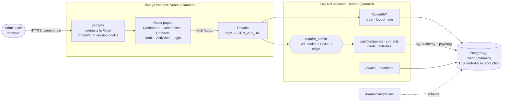
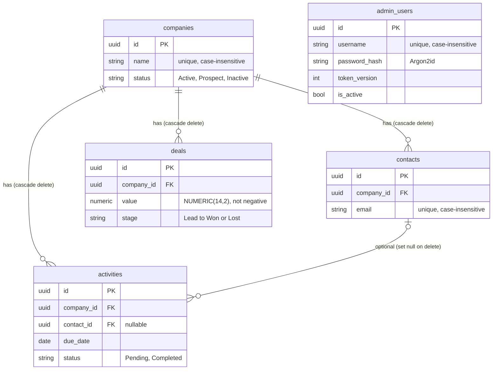
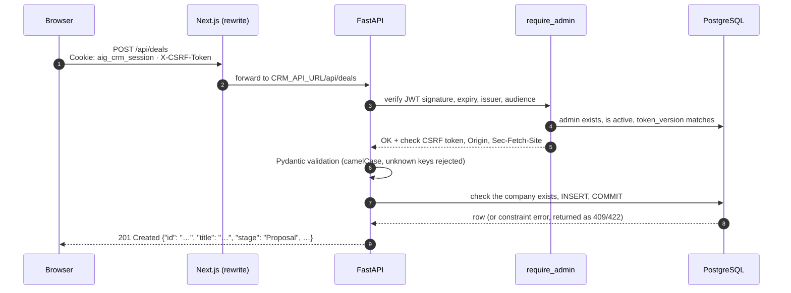
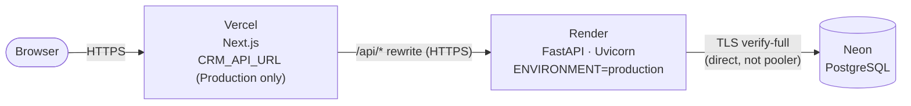

# AIG CRM Management Portal

**A full-stack CRM for managing companies, contacts, deals and activities: a Next.js frontend, a FastAPI backend, PostgreSQL, and admin authentication with secure sessions.**


> [!IMPORTANT]
> **Project status: the full stack runs locally, but it is not deployed yet.**
>
> | Area | Status |
> |---|---|
> | Frontend (5 CRM modules, login page) | ✅ Implemented on `feature/backend-api` |
> | FastAPI backend, PostgreSQL schema, migrations | ✅ Implemented and tested locally |
> | Admin authentication, CSRF and origin checks, security headers | ✅ Implemented and tested locally |
> | Production deployment (Neon + Render + Vercel) | ⏳ **Documented, not carried out** |
> | Live Vercel site | ⚠️ Still serves the **older, frontend-only version** from `main`, which uses in-browser mock data and has no backend or login |
>
> **Where the code lives:** the backend, authentication, database migrations and tests described in this README are on the [`feature/backend-api`](https://github.com/prakrithijain9/AIG---Crm-management-portal/tree/feature/backend-api) branch, which hasn't been merged into `main` yet. The `main` branch contains only the earlier frontend-only version.
>
> This is a portfolio project in active development. It is **not production-ready** (see [Known limitations](#-known-limitations)).

---

## 📑 Contents

- [Overview](#-overview)
- [Features](#-features)
- [Tech stack](#-tech-stack)
- [Architecture](#-architecture)
- [Project structure](#-project-structure)
- [How it works](#-how-it-works)
- [Local setup](#-local-setup)
- [Testing](#-testing)
- [API reference](#-api-reference)
- [Authentication and security](#-authentication-and-security)
- [Deployment](#-deployment)
- [Known limitations](#-known-limitations)
- [Engineering decisions and trade-offs](#-engineering-decisions-and-trade-offs)
- [About this project](#-about-this-project)

---

## 🧭 Overview

Sales and account teams often track customers, pipeline and follow-ups across spreadsheets and inboxes. This portal puts them in one place: **companies**, the **contacts** who work there, **deals** moving through a sales pipeline, and **activities** (calls, meetings, emails, tasks, follow-ups) tied to those accounts. A **dashboard** summarises all four.

| | |
|---|---|
| **Verified from the code** | Five CRM modules with create, read, update and delete for each entity; a dashboard computed from live API data; one user role (**admin**) with no public sign-up; admins are created from the command line. |
| **Assumptions** | The intended users are internal sales or account-management staff working through a small admin team. No user research or customer data backs this. All demo data is fictional and uses the reserved `.example` email domain. |

---

## ✨ Features

**Legend:** ✅ implemented and covered by automated tests · 🖐️ implemented, verified manually only · ⏳ not yet done

| Module | What it does | Status |
|---|---|---|
| **Dashboard** | Totals for companies, contacts, active deals and pending activities; deal count and value per pipeline stage; recent deals and activities. Computed from the same API-loaded state as the other pages. | 🖐️ |
| **Companies** | Create, view, edit and delete. Status (Active / Prospect / Inactive), industry, contact details. Names are unique regardless of case. Deleting a company cascades to its contacts, deals and activities. | ✅ API · 🖐️ UI |
| **Contacts** | People linked to a company. Emails are unique regardless of case. A contact can't move to another company while it has activities. Deleting a contact unlinks its activities instead of deleting them. | ✅ API · 🖐️ UI |
| **Deals** | Pipeline stages from Lead to Won/Lost, exact monetary values (`NUMERIC(14,2)`), expected close date. Shown as a table and as pipeline cards. | ✅ API · 🖐️ UI |
| **Activities** | Call / Meeting / Email / Task / Follow-up with a due date and status. The optional contact must belong to the activity's company, and the API enforces this with row locks. | ✅ API · 🖐️ UI |
| **Authentication** | Admin login and logout, session check, revocation of all sessions, and a CLI to create and reset admins. | ✅ |
| **Security** | CSRF tokens, Origin, Referer and `Sec-Fetch-Site` checks, strict CORS validation, security headers, production startup checks, and verified TLS to the database. | ✅ |
| **Search and filtering** | The UI filters loaded data in the browser. The API also supports server-side `search` and filters, but **the UI doesn't use them yet**. | 🖐️ UI · ✅ API |
| **Rate limiting, roles, password self-service** | Not implemented | ⏳ |

---

## 🧰 Tech stack

| Layer | Technologies |
|---|---|
| **Frontend** | Next.js 16.4 (App Router, `proxy.ts`), React 19.3, TypeScript 5, Tailwind CSS 4, Base UI and shadcn components, lucide-react icons |
| **Backend** | Python 3.13.5, FastAPI 0.143, Uvicorn, Pydantic 2 and pydantic-settings |
| **Database** | PostgreSQL (developed locally on PostgreSQL 18), SQLAlchemy 2.1 ORM, psycopg 3 driver, Alembic migrations |
| **Auth / security** | PyJWT (HS256 session tokens), pwdlib + argon2-cffi (Argon2id password hashing), certifi (CA bundle for database TLS) |
| **Testing** | pytest + HTTPX (FastAPI `TestClient`) against a dedicated PostgreSQL test database; Node's built-in test runner for the frontend; ESLint |
| **Deployment (planned)** | Vercel (frontend), Render (backend), Neon (PostgreSQL) |

Backend dependencies are pinned to exact versions in [`backend/requirements.txt`](https://github.com/prakrithijain9/AIG---Crm-management-portal/blob/feature/backend-api/backend/requirements.txt).

---

## 🏗️ Architecture



The browser only talks to the Next.js origin. Next.js forwards `/api/*` to FastAPI server-side, so the session cookie belongs to the frontend's domain. Because the backend URL (`CRM_API_URL`) is a server-only variable, it never reaches the browser bundle.

### Data model



Every CRM table has a UUID primary key and `created_at` / `updated_at` timestamps. The full column list is in [NOTES.md: CRM data model](https://github.com/prakrithijain9/AIG---Crm-management-portal/blob/feature/backend-api/NOTES.md#crm-data-model).

---

## 📁 Project structure

This tree reflects the `feature/backend-api` branch. The `backend/` folder, `proxy.ts`, the login page and the auth components don't exist on `main` yet.

```text
aig-crm/
├── app/                          # Next.js App Router
│   ├── (crm)/                    # Signed-in route group
│   │   ├── layout.tsx            # Session gate + app shell
│   │   ├── page.tsx              # Dashboard
│   │   ├── companies/  contacts/  deals/  activities/
│   ├── login/page.tsx
│   ├── layout.tsx                # Root layout (SessionProvider)
│   └── globals.css
├── components/
│   ├── auth/                     # Login form, session provider
│   ├── crm/                      # Data provider, tables, entity dialogs, form fields
│   ├── layout/                   # App shell, sidebar, page header
│   └── ui/                       # shadcn / Base UI primitives
├── lib/
│   ├── api.ts                    # Typed fetch client, CSRF handling, paging
│   ├── auth.ts                   # Cookie name, safe ?next= redirects
│   ├── types.ts  format.ts  utils.ts
│   ├── mock-data.ts              # Original demo data (source of the backend seed, no longer imported)
│   └── *.test.ts                 # Frontend unit tests
├── proxy.ts                      # Next.js 16 proxy (formerly middleware): login redirect
├── next.config.ts                # Security headers + /api rewrite to FastAPI
├── backend/
│   ├── app/
│   │   ├── main.py               # FastAPI app, CORS, router wiring
│   │   ├── api/                  # auth, health, companies, contacts, deals, activities, common
│   │   ├── core/                 # config (settings + startup checks), security, admins
│   │   ├── db/                   # engine/session, base mixins, safe error descriptions
│   │   ├── models/               # SQLAlchemy models
│   │   ├── schemas/              # Pydantic request/response models (camelCase API)
│   │   └── seed/                 # Demo data + idempotent seed logic
│   ├── alembic/versions/         # 2 migrations: CRM tables, admin_users
│   ├── scripts/                  # create_dev_db, create_admin, reset_admin_password, seed_demo_data
│   ├── tests/                    # pytest suite
│   ├── requirements.txt  .python-version  .env.example  alembic.ini  pytest.ini
├── NOTES.md                      # Detailed engineering notes
└── package.json
```

---

## ⚙️ How it works

1. **Page request.** `proxy.ts` sends any visitor without the `aig_crm_session` cookie to `/login?next=…`. This is only an early redirect. The backend does the real session check on every request.
2. **Sign-in.** The login form calls `POST /api/auth/login`. FastAPI verifies the Argon2id hash, sets an **HttpOnly** session cookie containing a signed JWT, and returns a CSRF token. The frontend keeps the CSRF token in memory only.
3. **Data load.** `CrmProvider` loads all four lists in parallel, following pagination through the `X-Total-Count` header. All pages, including the dashboard, read from this shared state.
4. **Writes.** Create, update and delete requests send the `X-CSRF-Token` header. The UI updates local state from the **server's response** and mirrors the database's cascade rules locally.
5. **Expiry and revocation.** Any `401` sends the user to `/login?reason=expired`. After signing in again, they return to the page they were on.

### Example: creating a deal



```http
POST /api/deals
Content-Type: application/json
X-CSRF-Token: <token from login or /api/auth/me>

{"title": "Fleet expansion", "companyId": "6f1c…", "value": 186000,
 "stage": "Proposal", "expectedCloseDate": "2026-10-22"}
```

---

## 💻 Local setup

> The commands below are the ones documented and used during development, on **Windows PowerShell**. The macOS/Linux equivalents are given for convenience and **haven't been verified**.

### Prerequisites

- **Python 3.13** (`backend/.python-version` pins 3.13.5)
- **PostgreSQL** running on `localhost:5432` (developed against PostgreSQL 18), plus the superuser password for the one-time database setup
- **Node.js** with npm. No version is pinned. The frontend tests use Node's built-in TypeScript support and were rerun with Node 24.21.0.

### 0. Get the code

The full-stack version is on the `feature/backend-api` branch:

```bash
git clone https://github.com/prakrithijain9/AIG---Crm-management-portal.git
cd AIG---Crm-management-portal
git checkout feature/backend-api
```

### 1. Backend

From `backend/`:

```powershell
py -3.13 -m venv .venv
.venv\Scripts\python -m pip install -r requirements.txt
Copy-Item .env.example .env       # then edit .env (see the table below)
```

<details>
<summary>macOS / Linux (unverified)</summary>

```bash
python3.13 -m venv .venv
.venv/bin/python -m pip install -r requirements.txt
cp .env.example .env
```

On macOS/Linux, replace `.venv\Scripts\` with `.venv/bin/` and `\` with `/` in all the commands below.
</details>

Environment variables (`backend/.env`, which is git-ignored; the template is [`backend/.env.example`](https://github.com/prakrithijain9/AIG---Crm-management-portal/blob/feature/backend-api/backend/.env.example)):

| Variable | Local value | Notes |
|---|---|---|
| `ENVIRONMENT` | `development` | Any other value except `test` is treated as **production** (stricter checks) |
| `DB_HOST` / `DB_PORT` | `localhost` / `5432` | |
| `DB_USER` | `aig_crm` | Role created by `create_dev_db.py` |
| `DB_PASSWORD` | `<your-local-db-password>` | **Secret.** Never commit it. |
| `DB_NAME` | `aig_crm_dev` | |
| `TEST_DB_NAME` | `aig_crm_test` | Must differ from `DB_NAME` and end in `_test` |
| `CORS_ORIGINS` | `http://localhost:3000` | Comma-separated exact origins. `*` is rejected. |
| `JWT_SECRET_KEY` | `<random, 32+ characters>` | **Secret.** Generate it with the command below. |

Optional: `TRUSTED_ORIGINS` (defaults to `CORS_ORIGINS`), `COOKIE_SECURE`, `DB_SSLMODE`, `DB_SSLROOTCERT`, `JWT_EXPIRE_MINUTES` (default 480).

```powershell
.venv\Scripts\python -c "import secrets; print(secrets.token_urlsafe(64))"   # use the output as JWT_SECRET_KEY
```

### 2. Database

```powershell
.venv\Scripts\python scripts\create_dev_db.py   # prompts for the PostgreSQL superuser password
.venv\Scripts\alembic upgrade head              # creates the CRM tables and the admin_users table
.venv\Scripts\python scripts\create_admin.py    # creates the first admin (hidden prompts)
.venv\Scripts\python scripts\seed_demo_data.py --apply   # optional: 34 fictional demo records
```

- `create_dev_db.py` creates a non-superuser login role `aig_crm`, the `aig_crm_dev` database, and the `aig_crm_test` database for tests. It only creates what's missing and **never drops anything**.
- The seed script is a read-only **dry run** unless you pass `--apply`. It only inserts records, can safely run more than once, and refuses to touch test databases.
- Admin usernames are 1–150 characters. Passwords are 12–256 characters and can't equal the username. Passwords are never accepted as command-line arguments.

### 3. Run

```powershell
# Terminal 1, from backend/
.venv\Scripts\python -m uvicorn app.main:app --reload
#   http://127.0.0.1:8000/health      liveness
#   http://127.0.0.1:8000/health/db   real database query
#   http://127.0.0.1:8000/docs        interactive OpenAPI docs (development/test only)

# Terminal 2, from the repository root
npm install
npm run dev        # http://localhost:3000 → /login; /api/* is proxied to FastAPI
```

Set `CRM_API_URL` before `npm run dev` or `npm run build` if the backend isn't at `http://127.0.0.1:8000`.

Troubleshooting tips are in [NOTES.md: Troubleshooting](https://github.com/prakrithijain9/AIG---Crm-management-portal/blob/feature/backend-api/NOTES.md#troubleshooting).

---

## 🧪 Testing

```powershell
# Backend: needs PostgreSQL and the aig_crm_test database (from backend/)
.venv\Scripts\python -m pytest -v

# Frontend (from the repository root)
npm run test:frontend
npm run lint
npm run build
```

| Check | Result | Evidence |
|---|---|---|
| `npm run test:frontend` | **26 passed, 0 failed** | ✅ Rerun on 2026-10-15 (Node 24.21.0) |
| Backend `pytest` | 504 passed | 📄 Recorded in [NOTES.md](https://github.com/prakrithijain9/AIG---Crm-management-portal/blob/feature/backend-api/NOTES.md#current-results), **not rerun** while writing this README because it needs a live database |
| `tsc --noEmit`, `npm run lint`, `npm run build` | pass / 0 problems / succeeds | 📄 Recorded in NOTES.md, not rerun |

**What the backend suite covers:**

- **Migrations:** a single head, downgrade/upgrade round trip, and a check that the models match the migrated schema.
- **Database constraints:** each assertion names the exact constraint that fired.
- **API:** CRUD for all four resources, pagination, search (including escaping `%` and `_`), error mapping and CORS.
- **Authentication:**
  - login, expired, tampered and foreign tokens, revocation, and CSRF checks on every write
  - a `401` for every CRM route when there's no session
  - the admin creation and password reset scripts
- **Settings:** startup validation and the database TLS settings.
- **Seed:** idempotence and the safety guards.

**Test isolation:** tests run only against `aig_crm_test`, and `conftest.py` refuses any database whose name doesn't end in `_test`. The schema is rebuilt from the real migrations, and each test runs inside a transaction that's rolled back afterwards. The authentication tests use a test-only secret and a test admin.

---

## 📡 API reference

Interactive docs are at `/docs` in development and test only (disabled in production). Every route below was checked against the FastAPI routers in `backend/app/api/`.

### Public

| Method | Path | Purpose |
|---|---|---|
| GET | `/health` | Liveness check: `{"status":"ok"}` |
| GET | `/health/db` | Readiness check: runs a real query and returns the database name and server version. Errors return 503 with only the exception type. |
| POST | `/api/auth/login` | `{username, password}` → sets the session cookie and returns `{username, csrfToken, expiresAt}` |
| POST | `/api/auth/logout` | Revokes **all** of the admin's sessions and clears the cookie (204) |
| GET | `/api/auth/me` | Returns the current admin and the session's CSRF token (401 if not signed in) |

### CRM resources (admin session required; writes also need `X-CSRF-Token`)

| Resource | List / Create | Read / Update / Delete | List query parameters |
|---|---|---|---|
| Companies | `GET` · `POST /api/companies` | `GET` · `PATCH` · `DELETE /api/companies/{id}` | `search`, `status` |
| Contacts | `GET` · `POST /api/contacts` | `GET` · `PATCH` · `DELETE /api/contacts/{id}` | `search`, `companyId` |
| Deals | `GET` · `POST /api/deals` | `GET` · `PATCH` · `DELETE /api/deals/{id}` | `search`, `stage`, `companyId` |
| Activities | `GET` · `POST /api/activities` | `GET` · `PATCH` · `DELETE /api/activities/{id}` | `search`, `status`, `type`, `companyId`, `contactId` |

- **Pagination:** every list accepts `limit` (default 100, maximum 500) and `offset`. Lists return a plain JSON array, and the total count is in the `X-Total-Count` header.
- **JSON format:** request and response bodies use **camelCase** field names. Unknown fields are rejected. `PATCH` only changes the fields you send.
- **Status codes:**
  - `201` create, `204` delete
  - `401` no or invalid session
  - `403` CSRF or origin check failed
  - `404` record not found
  - `409` duplicate name or email, or a conflicting change
  - `422` validation error, in FastAPI's standard error format

Full endpoint behaviour and examples are in [NOTES.md: CRUD API](https://github.com/prakrithijain9/AIG---Crm-management-portal/blob/feature/backend-api/NOTES.md#crud-api).

---

## 🔐 Authentication and security

Every item below is implemented in the code and covered by automated tests. The backend suite covers sessions, CSRF and settings; `lib/next-config.test.ts` covers the security headers.

### Sessions

- **Single role:** the only user type is **admin**. There's no public registration. Admins are created and reset only from the CLI.
- **Password hashing:** passwords are hashed with Argon2id, and each hash is verified before it's stored. Unknown usernames are checked against a dummy hash so that response timing doesn't reveal which accounts exist. Every failed login returns the same message.
- **Session token:** a signed **HS256 JWT** with issuer, audience, expiry and a token version. On every request, the backend also checks that the admin still exists and is active.
- **Cookie:** `HttpOnly` and `SameSite=Lax`, and `Secure` outside development and test. The JWT is never visible to JavaScript, and nothing is stored in `localStorage`.
- **Revocation:** logging out, resetting a password, or incrementing `token_version` signs out every session for that admin.

### Request protection

- **CSRF and origin checks:**
  - Every write must send a CSRF token that's bound to the session.
  - Login, logout and all writes reject an `Origin` or `Referer` that isn't in `TRUSTED_ORIGINS`.
  - They also reject any `Sec-Fetch-Site` value other than `same-origin` or `none`.
- **CORS:** only exact origins that pass validation are allowed. `*`, `null`, paths and embedded credentials stop the API from starting, which matters because credentials are allowed.
- **Security headers:** sent on every response from Next.js:
  - `Content-Security-Policy: frame-ancestors 'none'` and `X-Frame-Options: DENY`
  - `X-Content-Type-Options: nosniff`
  - `Referrer-Policy: strict-origin-when-cross-origin`
  - a restrictive `Permissions-Policy`
- **Login redirects:** the `?next=` parameter on the login page only accepts paths on the same site, so it can't be used as an open redirect.

### Production configuration

- **Startup checks:** in production, the API refuses to start in any of these cases:
  - `JWT_SECRET_KEY` is missing or shorter than 32 characters
  - `COOKIE_SECURE=false`
  - `DB_SSLMODE` is weaker than `verify-full`
- **Database TLS:** in production the connection uses `verify-full`, which checks the server's certificate and hostname against the certifi CA bundle.
- **Secret hygiene:**
  - The database password is stored as a `SecretStr`, and SQLAlchemy is configured to hide query parameters.
  - Settings validation errors never echo input values.
  - Database errors are logged by constraint name only, without row values.
- **API docs:** `/docs` and `/openapi.json` are disabled in production.

> [!WARNING]
> **Login attempts aren't rate-limited yet.** Argon2id slows down each guess, but nothing throttles repeated attempts or locks accounts. Add rate limiting before any public exposure.

---

## 🚀 Deployment



| Step | Status |
|---|---|
| Vercel project serving `main` | ✅ Live, but with the **older frontend-only** version |
| Neon database provisioned | ⏳ Pending / unverified |
| Render web service for FastAPI | ⏳ Pending / unverified |
| Migrations and first admin on Neon | ⏳ Pending |
| `CRM_API_URL` set on Vercel, then merge into `main` | ⏳ Pending |

**Planned procedure** (full detail, including how to enter secrets safely, is in [NOTES.md: Deployment](https://github.com/prakrithijain9/AIG---Crm-management-portal/blob/feature/backend-api/NOTES.md#deployment-render--neon--vercel)):

1. **Neon:** create the database and a dedicated role. Use the **direct** host and split the connection string into the `DB_*` variables (the app doesn't read `DATABASE_URL`).
2. **Render:** create a web service with these settings:
   - Root directory `backend`
   - Build command `pip install -r requirements.txt`
   - Start command `uvicorn app.main:app --host 0.0.0.0 --port $PORT`
   - Health check path `/health`
   - Environment: `ENVIRONMENT=production`, the `DB_*` variables, `JWT_SECRET_KEY` (secret), `CORS_ORIGINS` (the Vercel origin), and `PYTHON_VERSION=3.13.5`
3. **Run migrations and create the first admin, once:** run `alembic upgrade head` and then `python scripts/create_admin.py` against Neon.
4. **Check the backend:**
   - `/health` returns ok
   - `/health/db` names the Neon database
   - `/api/companies` returns `401`
   - `/docs` returns `404`
5. **Vercel:** set `CRM_API_URL` to the Render URL for **Production only**, *before* the production build. Then merge into `main`, and confirm the login redirect, the sign-in flow and the security headers.

> [!CAUTION]
> Don't merge `feature/backend-api` into `main` before `CRM_API_URL` is set in Vercel. The production build would otherwise proxy `/api` to the local default (`127.0.0.1:8000`), and the live site would break.

---

## 🚧 Known limitations

- **Not deployed.** The full stack has only run locally. There's no production logging or monitoring, and no CI pipeline in this repository.
- **No login rate limiting or lockout.**
- **Admin-only auth.** There are no roles or permissions, and the first admin is created from the CLI. Passwords can only be recovered with the server-side reset script; there's no self-service password reset.
- **Client-side search.** The UI filters data it has already loaded. The server-side search and filters exist in the API but aren't used yet.
- **Data freshness.** Data loads once per page load. Changes made in another tab or by another user appear only after a reload.
- **Frontend tests cover the API client, auth helpers and config only.** UI behaviour has been verified manually.
- **Scaling.** Search uses `ILIKE '%term%'` with no trigram indexes. Lists are capped at 500 items per request.
- **The activity–contact company rule** is enforced in the API (with row locks), not as a database constraint.
- **Builds aren't fully reproducible.** Direct backend dependencies are pinned, but there's no lock file for transitive Python packages.

### Possible next steps

- Deploy to Neon, Render and Vercel, then verify the end-to-end checks listed above
- Rate-limit login attempts
- Add CI that runs pytest (with a PostgreSQL service container), the frontend tests, lint and build
- Use server-side search and pagination in the UI
- Add role-based permissions and an audit trail
- Add component and end-to-end tests (for example, Playwright)

---

## 🧠 Engineering decisions and trade-offs

| Decision | Why | Trade-off |
|---|---|---|
| **Same-origin `/api` proxy** through Next.js rewrites | No CORS in the browser path. The cookie belongs to the frontend domain. The backend URL stays server-side. | `CRM_API_URL` is read at build time, so changing it requires a rebuild. There's also one extra hop per request. |
| **HttpOnly cookie JWT + CSRF token** instead of a bearer token in `localStorage` | Script running in the page can't read the session token | Requires CSRF and origin checks on every write |
| **`token_version` claim** | Instant revocation without a token store | One database read per request to check the version |
| **Database constraints as the final authority** (uniqueness, CHECKs, foreign keys) | Avoids race conditions where two requests both pass a check before either inserts. Constraint errors are mapped to clean `409`/`422` responses. | Constraint names must stay stable, so they follow an explicit naming convention |
| **`VARCHAR` + CHECK** instead of native PostgreSQL enums | Adding a value is a simple constraint change | Less type information in the database itself |
| **`NUMERIC(14,2)` / `Decimal` for money** | Exact arithmetic, no floating-point rounding | Values are serialised as JSON numbers to match the frontend type |
| **camelCase API, snake_case database** | Matches the frontend's existing types. Unknown fields fail loudly. | Requires an alias layer in the schemas |
| **Fail-closed production settings** | A misconfiguration stops startup instead of running insecurely | Stricter setup. A typo in `ENVIRONMENT` is treated as production. |
| **Tests on a real PostgreSQL database** with rolled-back transactions | Exercises the real constraints, cascades and migrations | Needs a local PostgreSQL server to run the suite |
| **Hand-reviewed Alembic migrations** | Autogenerate produced duplicate CHECK constraints, which were fixed by hand | Takes manual review for each migration |

---

## 👋 About this project

I built this portfolio project to practise building a full-stack business application end to end: a typed React frontend, a FastAPI service with a constrained relational schema, real authentication, and documentation that's honest about what's done and what isn't. The most substantial work went into data integrity (constraints, transactions, row locks), security defaults that fail closed, and a test suite that runs against real PostgreSQL.

It was developed with the help of AI coding tools.

For deeper technical notes (the data model, every endpoint's behaviour, the seed safety rules, and the deployment runbook), see [**NOTES.md**](https://github.com/prakrithijain9/AIG---Crm-management-portal/blob/feature/backend-api/NOTES.md).
